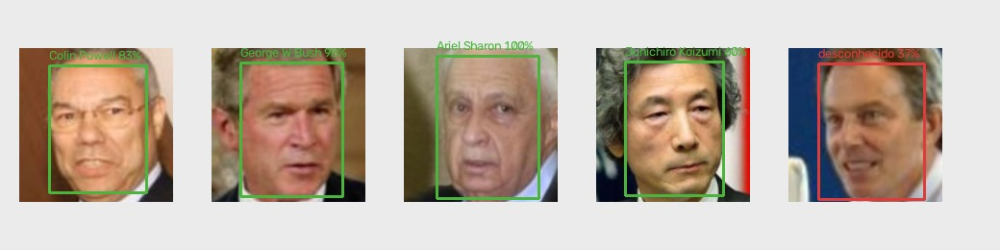
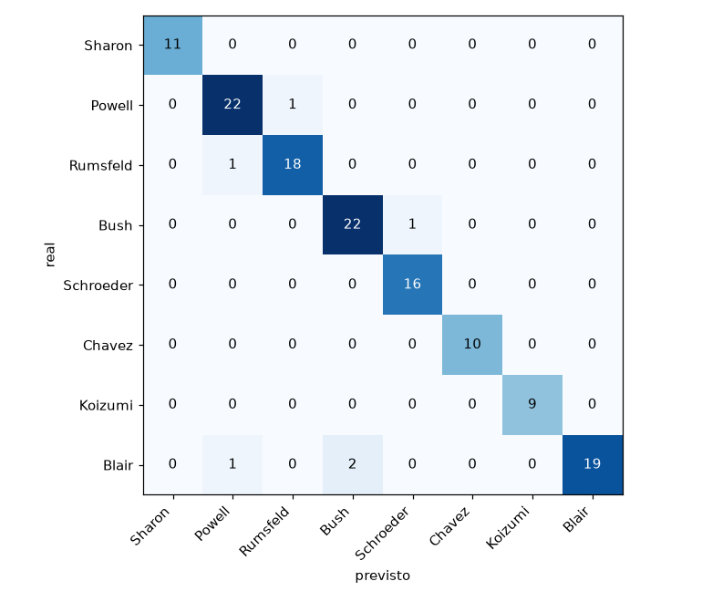

# Reconhecimento facial do zero

Desafio "Criando um Sistema de Reconhecimento Facial do Zero", da formação Machine Learning Specialist da DIO. O enunciado pede um sistema em TensorFlow que **detecte** rostos e use uma **rede de classificação** para reconhecer de quem é cada um, com mais de um rosto na mesma imagem.



*Cinco rostos do conjunto de teste, de pessoas diferentes, numa mesma imagem: quatro identificados. O último foi marcado como "desconhecido" porque a confiança ficou abaixo do limiar (veja abaixo).*

## Como funciona

O sistema tem duas redes, cada uma com o seu papel:

1. **Detecção: a YuNet** (OpenCV). É uma rede leve e pré-treinada que encontra todos os rostos da imagem, de qualquer tamanho, e devolve as caixas. Cada rosto é recortado num quadrado com folga em volta.
2. **Classificação: a MobileNetV2 com transfer learning.** Recebe o recorte e diz de quem é, com uma saída softmax por pessoa. A base da ImageNet é ajustada em duas fases: primeiro só a cabeça nova, depois as últimas 40 camadas, com taxa de aprendizado baixa e parada antecipada.

Os rostos usados no treino vêm do **LFW (Labeled Faces in the Wild)**, um conjunto público de fotos de rosto de pessoas públicas, muito usado em pesquisa. Ficaram as 8 pessoas com pelo menos 60 fotos, limitadas a 150 por pessoa (George W. Bush tem 530, e dominaria o treino). Também há pesos por amostra para equilibrar as pessoas com menos fotos. A divisão é estratificada: 617 fotos para treino, 132 para validação e 133 para teste.

## Resultado

| | |
| --- | --- |
| Acurácia no teste | **95,5%** |
| F1 médio entre as pessoas | **0,96** |
| Recall mais baixo | Tony Blair (0,86) |



Precisão e recall de cada pessoa estão em `resultados/metricas.json`.

**"Desconhecido" é uma resposta válida.** A rede só conhece as 8 pessoas do treino, e qualquer rosto vai receber *algum* nome com a maior probabilidade. Por isso, abaixo de 60% de confiança, o sistema responde "desconhecido" em vez de chutar. Na imagem acima, o rosto de Tony Blair ficou em 37%. Os recortes feitos pela YuNet são um pouco mais fechados que os do LFW usados no treino, e essa diferença derruba a confiança em alguns casos. Errar por excesso de cautela é melhor do que pôr o nome errado em alguém. O limiar é ajustável (`--limiar`).

## Usando com as suas fotos

```bash
pip install -e '.[dev]'
python -m faces.reconhecer foto_em_grupo.jpg --saida reconhecidos/
```

Para reconhecer **outras pessoas**, crie uma pasta com uma subpasta por pessoa e treine de novo. O sistema detecta e recorta o rosto de cada foto sozinho:

```
minhas_fotos/
  ana/     foto1.jpg foto2.jpg ...
  bruno/   ...
```

```bash
python -m faces.treinar --pasta minhas_fotos/
```

Sem `--pasta`, o treino usa o LFW, que é baixado (cerca de 230 MB) na primeira vez. Com GPU, o treino leva menos de um minuto.

| Arquivo | Papel |
| --- | --- |
| `faces/deteccao.py` | YuNet e o recorte do rosto |
| `faces/dados.py` | LFW, pasta própria e divisão treino/validação/teste |
| `faces/modelo.py` | a rede de classificação |
| `faces/treinar.py` | treino em duas fases, métricas e matriz de confusão |
| `faces/reconhecer.py` | detecção + reconhecimento de todos os rostos de uma imagem |

## Testes

```bash
pytest
```

Os testes cobrem o recorte (quadrado, com margem e sem sair da imagem), a conversão de cor e de escala dos pixels, a divisão estratificada sem repetir fotos entre as partes e a forma da saída da rede, que soma 1 por rosto. O GitHub Actions roda lint e testes a cada push.

O modelo de detecção (`modelo/face_detection_yunet_2023mar.onnx`) é do projeto [opencv_zoo](https://github.com/opencv/opencv_zoo), sob licença Apache 2.0.
